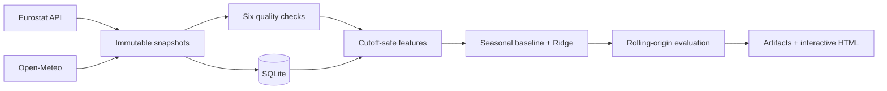

# Probabilistic Energy Data Observatory

An evidence-first MVP for **pseudo-real-time nowcasting** of Eurostat monthly electricity availability in France and Germany.

## What it estimates

The target is Eurostat **electricity available to the internal market** (`nrg_cb_em`, `E7000`, `AIM`, `GWH`). It is not labelled as demand, load or wholesale price. Verified coverage: **Germany 2008-01–2026-05 (221 observations), France 2008-01–2026-04 (220 observations)**.

## Current evidence

- Seasonal-naive aggregate MAE: **1,607.2 GWh**.
- Weather-adjusted Ridge aggregate MAE: **1,618.9 GWh**.
- H2 status: **NOT_SUPPORTED** under the pre-registered rule.
- Data-quality checks passed: **5/6**.
- Revision tracking: **COMPARED**.

The candidate is not declared better unless the rolling-origin results support that claim. HICP is shown as context and is excluded from model features.

## Architecture



## Reproduce on PowerShell

```powershell
.\.venv\Scripts\python.exe -m pip install -e .[dev]
.\.venv\Scripts\python.exe -m pytest
.\.venv\Scripts\python.exe -m energy_observatory.cli run
```

Open `docs/index.html` directly in a browser. It is self-contained and makes no API calls while viewed.

## Repository map

- `src/energy_observatory/`: ingestion, SQL, quality, features, model and reporting.
- `data/snapshots/`: timestamped source responses used by the run.
- `artifacts/`: machine-readable evidence and model outputs.
- `docs/index.html`: interactive recruiter-facing dashboard.
- `docs/technical_report.md`: assumptions, methods and results.
- `docs/model_card.md`: intended use and limitations.
- `tests/`: network-free regression and leakage checks.

## Limitations

- Paris and Berlin are weather proxies, not national aggregates.
- Exact historical source vintages are unavailable; evaluation is pseudo-real-time.
- A three-month publication lag is assumed conservatively.
- H1 (vintage-safe HICP as a model feature) is not tested.
- First-run revision status cannot show historical changes.

This repository publishes the documented MVP; results reflect the recorded run and its stated limitations.
